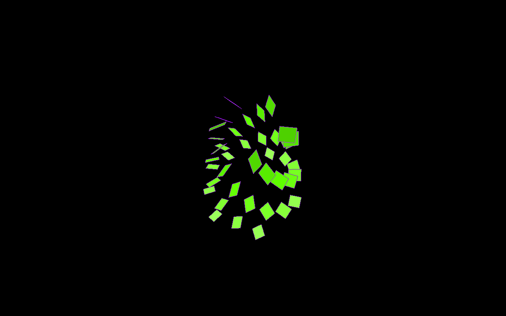
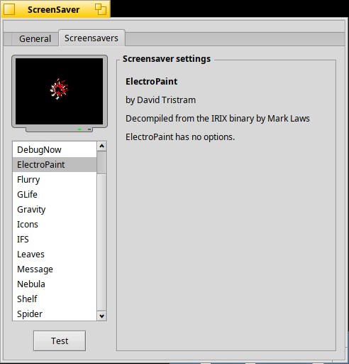

ElectroPaint for Haiku
======================

ElectroPaint, David Tristram's screen saver for Silicon Graphics IRIX
workstations, as a Haiku screen saver.

The animation is not a clone. It is a hand-written rewrite of `ep.c` from
[ElectroPortis](https://github.com/drvink/electroportis), Mark Laws'
machine decompilation of the original IRIX binary, and it makes the same
OpenGL calls with the same arguments, bit for bit (see
[Faithfulness](#faithfulness)).

Installing
----------

Install the package by double-clicking it (HaikuDepot) or with

    pkgman install electropaint-1.0.0-1-x86_64.hpkg

then open **Preferences ▸ ScreenSaver ▸ Screensavers** and select
*ElectroPaint*. The preview in the preferences shows it running; *Test*
starts it full screen. ElectroPaint has no options.

The package needs Mesa (`lib:libGL`), which Haiku installs by default.

Building
--------

On Haiku, with `haiku_devel` and `mesa_devel` installed:

    make                        # objects.*/ElectroPaint
    make install                # into ~/config/non-packaged/add-ons/Screen Savers
    package/build-package.sh    # out/electropaint-<version>-<arch>.hpkg

Install either the package or the non-packaged copy, not both: the screen
saver runner prefers the non-packaged one.

How the port works
------------------

* `src/ElectroPaintEngine.cpp` is the animation. ElectroPortis' `ep.c` is
  decompiler output that keeps the MIPS registers and stores pointers in
  32-bit words, so it only runs where pointers are 32 bits wide; Haiku runs
  on x86_64. The rewrite uses ordinary structures but keeps every floating
  point operation in the original's precision (float or double) and operand
  order, uses the same 48-bit random generator as `drand48()`, and reproduces
  the original's quirks on purpose (they are marked "As in ep.c" in the
  source). The projection is computed the way GLU's `gluPerspective()` does
  it, so the add-on does not need GLU.
* `src/ElectroPaintSaver.cpp` is the `BScreenSaver` add-on. Like Haiku's own
  OpenGL savers (Flurry, GLife) it adds a `BGLView` to the saver's view and
  uses direct mode under `screen_blanker`. The original is frame based and
  ran at 60 frames per second; the runner calls the add-on every 4 ms and
  the view draws whenever the next 60 Hz frame is due. A machine that cannot
  keep up skips up to three frames (the animation advances exactly as if
  they had been drawn) and slows down beyond that.

Differences from ElectroPortis
------------------------------

* The original draws every square four times: once as is and three times
  mirrored, scaled by a size that nothing ever sets, so the three copies
  collapse to a point. They never produce a pixel but cost three quarters of
  the drawing time, so the saver leaves them out. Rendered with Haiku's Mesa
  both ways, every pixel of every frame is the same (tests/haiku), and a
  frame takes about 1-2 ms instead of 3-6 ms on the test machine.
  `Engine::SetDrawInvisibleCopies(true)` restores the original's calls.
* ElectroPaint's script language has `seqkill:` and `seqkillall:`, which the
  built-in script does not use. In `ep.c` they hang or free memory that is
  still in use; here they kill the named sequences.
* `ep.c` reads past the end of the built-in script (its last line has no
  newline); the rewrite stops there.
* ElectroPortis' own window features (the `n` and `f` keys, multi-monitor
  modes) are not part of a screen saver; Haiku's screen saver framework
  decides where it runs.

Faithfulness
------------

`tests/reference/run-tests.sh` (Linux x86_64, needs gcc, python3 and the GL
headers) fetches `ep.c` from ElectroPortis at the commit the port was made
from, builds it unchanged except for its headers (as a non-PIE binary whose
memory all lies below 2 GB, where its 32-bit pointers work) and runs it next
to the engine with the same random seeds. Recording stubs replace OpenGL;
every call and argument must be identical:

* the built-in script, 36,000 frames (10 minutes) for each of four seeds,
  about 157 million identical calls per seed;
* frames skipped with `Display(false)` in between drawn ones;
* two more scripts with the commands the built-in script does not use
  (except `seqkill:` and `seqkillall:`), unsorted frames, blank and bad
  lines, more squares than history slots and out of range hues and angles;
* the projection for several window sizes.

It also runs the engine alone under AddressSanitizer and UBSan and writes
`tests/reference/enginetrace.expected`, a hash of the engine's calls.

`tests/haiku/run-vm-test.sh user@host` copies the project to a Haiku machine
and runs `tests/haiku/vm-test.sh` there: it builds the add-on without
warnings, checks that the Haiku build produces the same calls as the Linux
build (`enginetrace.expected`), compares the pixels drawn with and without
the invisible copies (OSMesa), installs the add-on and runs it in a window
(checking that it draws 60 frames per second), in `screen_blanker` and in the
ScreenSaver preferences, and checks the screenshots. It changes the
ScreenSaver settings while it runs and puts them back afterwards.

Credits
-------

* ElectroPaint by David Tristram (Tristram Visual).
* ElectroPortis, the decompilation of the IRIX binary, by Mark Laws.

See [LICENSE.md](LICENSE.md): the engine is covered by David Tristram's terms
for the decompilation (it may not be sold, and modified source should be
shared with him); the rest of the project is MIT licensed.
